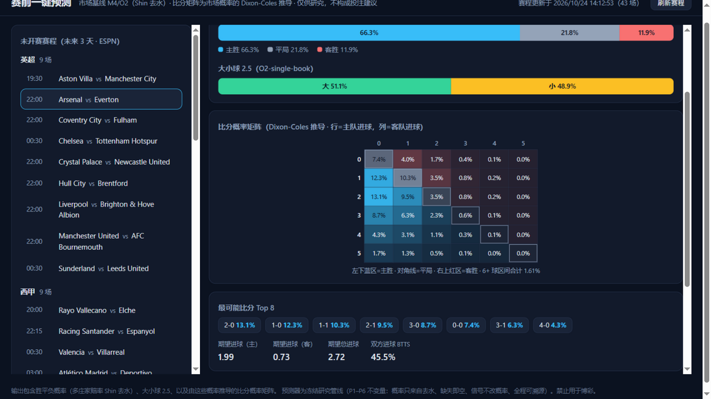
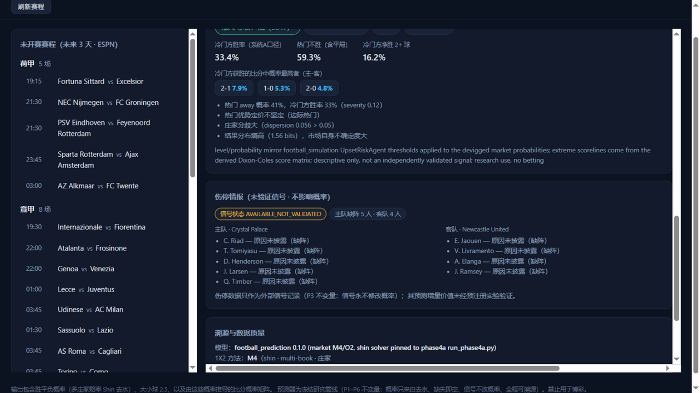

# ⚽ football-prediction · 赛前一键预测 WebApp

**打开页面 → 选一场未开赛的比赛 → 点一下 → 胜平负概率、比分概率矩阵、爆冷预警、伤停名单一次出全。**

一个可本地运行的足球赛前预测工作台：自动采集真实赛程与多庄家赔率，用已验证的市场基线模型（Shin 去水）输出概率，并推导比分概率矩阵与爆冷风险；伤停名单作为外部情报展示。全程可溯源，每一步都有证据等级标注。

<p align="center">
  
</p>

---

## 它能做什么

对**未开赛**的比赛，一键输出：

| 输出 | 来源 | 性质 |
|---|---|---|
| **胜平负概率**（1X2） | 多庄家赔率 → Shin 去水（`M4`，多书均值；回退 `M2` 单书） | 已验证基线（3504 场冻结测试集 + Phase 4A 零不匹配） |
| **大小球 2.5**（O/U） | B365 盘口对 Shin 去水（`O2`；回退多书 `O4`） | 已验证基线 |
| **比分概率矩阵** | 去水概率的 Dixon-Coles 双变量泊松重参数化 + raking，聚合量与去水概率精确一致（≤1e-9） | 派生（Derived） |
| **爆冷风险预警** | 相对赛前概率的冷门等级/方向/严重度（阈值对齐沙盘引擎的 UpsetRiskAgent）+ 市场分歧、极端冷门比分 | 派生（Derived） |
| **伤停情报** | API-Football 真实缺阵名单（主/客分列） | 外部信号，只展示不改概率 |
| **溯源面板** | shin_z、overround、庄家清单、时间安全状态、置信分级、完整 JSON | 全程可审计 |

<p align="center">
  
</p>

## 快速开始

```bash
# 依赖：Python 3.10+，pydantic、numpy
pip install pydantic numpy

# 启动
python -m football_prediction.cli serve --port 8600
# 浏览器打开 http://127.0.0.1:8600
```

Windows 下也可以直接双击仓库里的 `start_prediction.bat`（自动起服务 + 打开浏览器）。

不配任何 API key 也能用：赛程与 DraftKings 赔率来自 ESPN（免费、无 key）。接入以下 key 后自动增强：

| 数据源 | 用途 | 免费额度 | 配置 |
|---|---|---|---|
| [the-odds-api](https://the-odds-api.com) | 多庄家赔率（Pinnacle/William Hill/Ladbrokes 等 40+ 家） | 500 credits/月（每次预测 4） | `echo 你的key > config/odds_api.key` |
| [API-Football](https://www.api-sports.io) | 伤停/停赛名单 | 100 请求/天（每次预测 2） | `echo 你的key > config/api_football.key` |
| ESPN | 赛程 + 基础赔率 | 免费，无需 key | — |

key 文件已被 `.gitignore` 排除，不会入库。

## 工作原理

```
ESPN 赛程 ──► 状态门（只放行未开赛）──► 赔率采集（ESPN + the-odds-api 多书合并）
                                              │
                                              ▼
                              prediction_input.v1（时间安全：retrieved_at < 开球）
                                              │
                                              ▼
                     冻结预测器 predict_match（Shin 去水，P1–P6 不变量）
                                              │
                        ┌─────────────────────┼─────────────────────┐
                        ▼                     ▼                     ▼
                   比分概率矩阵           爆冷风险预警          伤停外部信号
                （Dixon-Coles 推导）   （Derived，不改概率）  （门控，永不改概率）
```

**诚实的置信分级**：概率数字之外，系统明确告诉你输入质量——`VALID`（≥4 家庄家、含 B365、无回退）→ `HIGH` 置信；单庄家回退链（当前 ESPN 只有 DraftKings 一家）会如实降级为 `CONDITIONAL` / 置信 `LOW`。**LOW 不代表数字不可信**，它说明"只有一家定价、缺乏跨庄家一致性证据"。

**三条铁律**（冻结管线的 P1–P6 不变量，代码层强制）：

1. 概率只来自去水，缺失赔率输出空值，绝不伪造；
2. 外部信号（伤停、xG 等）**永不修改概率**，状态封顶"可用未验证"；
3. 每个输出带证据等级（Evidence / Derived / Hypothesis）与完整溯源。

## HTTP API

```bash
GET  /api/health                 # 服务状态 + 数据源配置情况
GET  /api/fixtures?refresh=1     # 未开赛赛程（ESPN，未来 3 天）
POST /api/predict                # {"event_id":"...", "force":false}
```

`POST /api/predict` 错误码：`404 EVENT_NOT_FOUND`、`409 MATCH_NOT_PRE`（已开赛，时间安全门拦截）、`409 NO_ODDS`、`502 ESPN_UNREACHABLE`。10 分钟内同场重复预测走缓存（0 配额消耗）。

## 仓库里还有什么

这是一个双系统仓库，预测工作台是面向使用者的主入口；仓库同时包含一个**沙盘模拟引擎**（`src/football_simulation/`：世界模型 + 35 条知识规则 + 蒙特卡洛比赛推演，全部运行在合成数据上，35 条规则均为 tentative——它是研究脚手架，不是预测器）。预测器与沙盘严格隔离，后者不影响任何真实概率输出。

```
src/
├── football_prediction/     # 预测管线（本页主角）
│   ├── predictor.py         #   冻结预测器（Shin 去水 + P1–P6）
│   ├── score_matrix.py      #   比分概率矩阵（Dixon-Coles + raking）
│   ├── upset_risk.py        #   爆冷风险（阈值对齐 UpsetRiskAgent）
│   ├── odds_feed.py         #   ESPN 赛程/赔率适配器
│   ├── odds_api.py          #   the-odds-api 多庄家适配器
│   ├── injuries_feed.py     #   API-Football 伤停适配器
│   ├── signals.py           #   外部信号门控（P3）
│   ├── service.py           #   编排（采集→预测→增强→审计日志）
│   ├── webapp.py            #   HTTP 服务（纯标准库）
│   └── static/index.html    #   前端单页（零构建）
└── football_simulation/     # 沙盘模拟引擎（研究脚手架，合成数据）
docs/                        # 架构/规范/验证报告（PREDICTION_WEBAPP.md 从这开始）
backtest_output/dataset_build/freeze/1.1.0/   # 冻结数据集 v1.1.0（预测器自检依赖）
tests/                       # 95+ 单测（含 P3 概率不变断言）
```

## 测试

```bash
python -m pytest tests -q -m "not slow"
```

核心断言举例：比分矩阵聚合量与去水概率逐位一致；有无伤停信号时预测输出**逐位相等**（P3）；开赛后赔率触发时间安全拒绝；爆冷等级阈值与系统 A 逐例对齐。

## 文档

- [一键预测 WebApp 使用与设计](docs/PREDICTION_WEBAPP.md)（API、key 配置、诚实性设计）
- [预测模块规范](docs/PREDICTION_MODULE_SPEC.md) · [预测矩阵与不变量](docs/PREDICTION_MATRIX.md)
- [架构总览](docs/architecture.md) · [沙盘引擎 V1.1 真实性验证](docs/V1_1_REALITY_VALIDATION_REPORT.md) · [V1.2 回测报告](docs/V1_2_HISTORICAL_BACKTEST_REPORT.md)

## 声明

本项目仅供研究学习。输出是**市场隐含概率及其派生量**，不构成任何投注建议；禁止用于博彩。数据来自 ESPN、the-odds-api、API-Football 公开接口，版权归各自所有者。

## License

[MIT](LICENSE)
